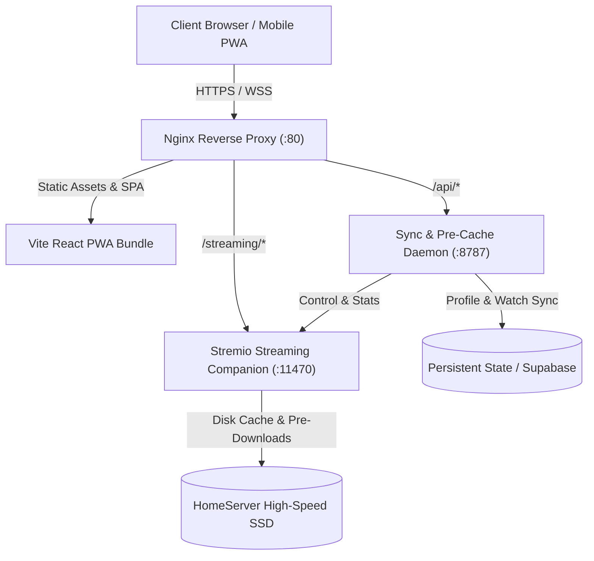
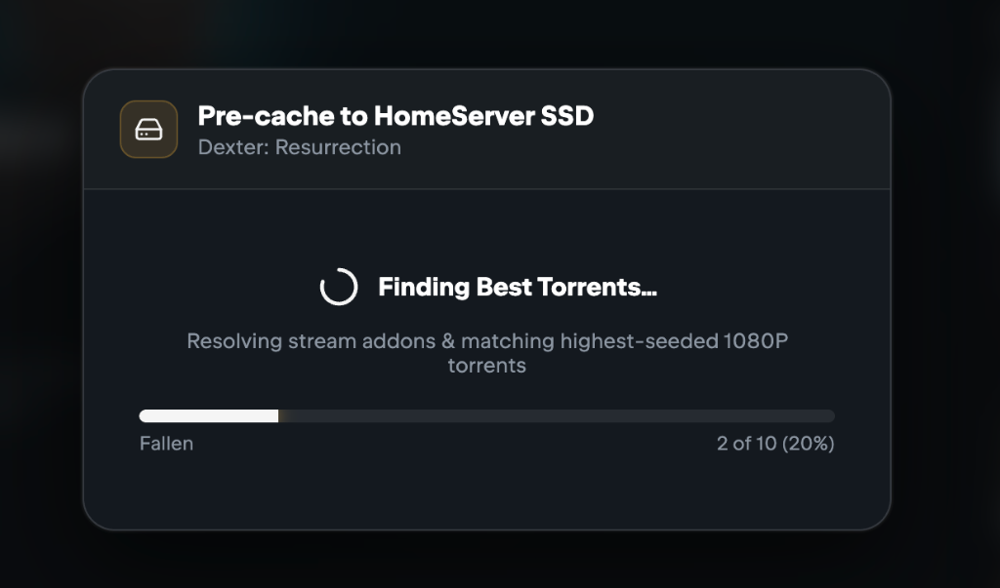
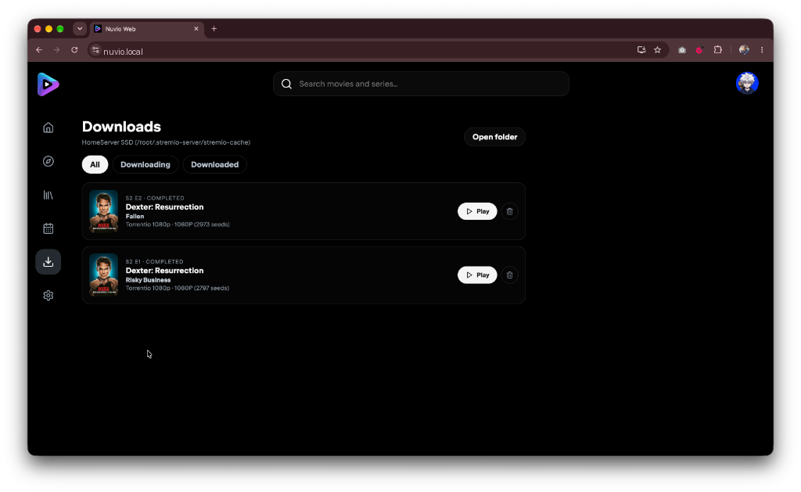
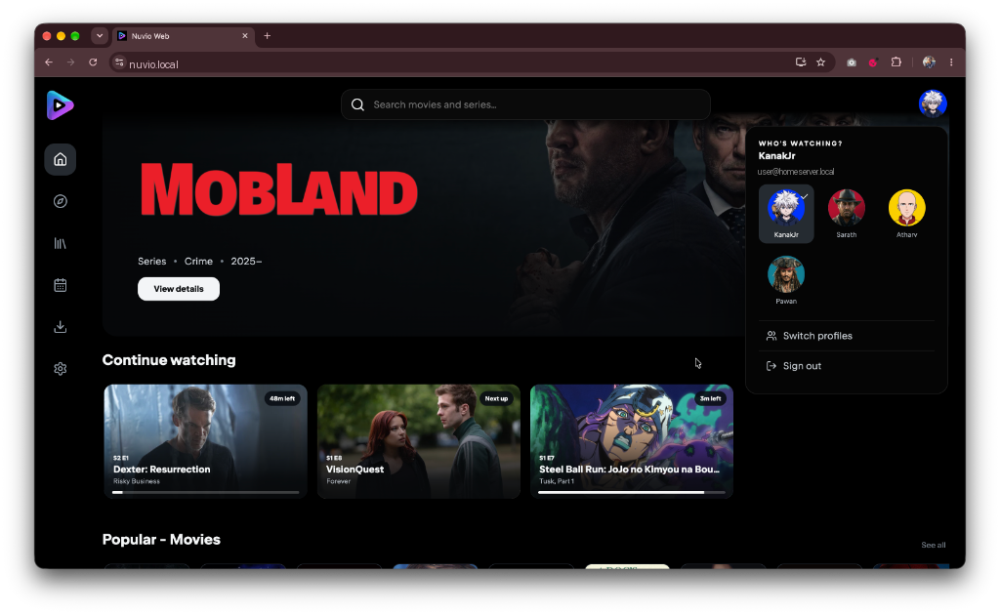

# Nuvio Web (HomeServer Edition) 🚀

> **High-Performance PWA Streaming Client** with Native 4K/HDR Seeking Optimization, Direct Server-Side Torrent Pre-Caching, Background Batch Queue, and Integrated In-App Swarm Download Manager.

---

## 📖 Overview & Upstream Heritage

**Nuvio Web (HomeServer Edition)** is an advanced, high-performance fork of the open-source [Nuvio Web PWA](https://github.com/lucaboox/nuvio-web) by `@lucaboox`. 

While upstream provides a clean, mobile-first browser interface for Nuvio accounts and Stremio addons, this edition introduces **HomeServer Superpowers**: transforming the lightweight PWA into a media powerhouse capable of streaming 4K HDR torrents without buffering, pre-caching entire series directly to server SSD storage, and managing torrent swarms through a unified web interface.



---

## ✨ Features Added in This Edition

### 1. ⚡ Zero-Deadlock 4K/HDR Seeking & WebCodecs Engine
- **Eliminated Seek Freezes**: Redesigned seeking queue in [`mediabunnyPlayer.ts`](src/lib/mediabunnyPlayer.ts) so that scrubs cancel obsolete in-flight requests immediately rather than blocking until buffer drains.
- **Zeroed Memory Overhead**: Eliminated 33 MB memory buffer allocations per frame during 4K HEVC playback.
- **Dynamic Frame Dropping**: Drops non-keyframe backlog automatically under heavy CPU/GPU loads to maintain audio/video sync without choppiness.

### 2. 💾 Direct Server-Side Torrent Pre-Caching
- **SSD Pre-Download Daemon**: Lightweight companion daemon ([`server.cjs`](server.cjs)) bridges client requests to the backend streaming engine.
- **Bypasses Browser Constraints**: Downloads persist on the server SSD at multi-gigabit speeds without holding browser tabs open.
- **Accurate Disk Detection**: Inspects underlying `streamProgress` to accurately report files completed on disk, even when network activity is idle.

### 3. 🎯 Quality-Aware Batch Pre-Caching
- **One-Click Series Caching**: Cache individual episodes or entire seasons from the details modal with resolution filtering (**4K**, **1080p**, **720p**).
- **Intelligent Stream Matcher**: Analyzes titles and seeds across all active addons (Torrentio, Comet, MediaFusion, etc.) to automatically pick the highest-seeded release matching your target quality.



### 4. 🔄 Non-Blocking Background Enqueueing
- **Floating Status Widget**: Initiating batch pre-caching immediately closes the modal and presents a sleek, non-blocking floating widget in the bottom corner.
- **Real-Time Progress**: Tracks addon resolution and queue progress in the background while you continue browsing or watching.

### 5. 📥 Embedded Library Download Manager & Swarm Telemetry
- **Dedicated Downloads Tab**: Seamlessly integrated into Library (`/library?tab=downloads`) and dedicated sidebar navigation.
- **Live Swarm Telemetry**: Real-time display of download speeds (MB/s), downloaded percentage, total size, connected peers, and swarm health.
- **Direct Instant Playback**: Stream directly from the local server SSD without buffer stalls while the download progresses.
- **Navigation Badge**: Unread/active download count pill rendered on the desktop navigation rail and mobile bar.



### 6. 🔐 Zero-Trust SSO & Multi-Profile Management
- **Cloudflare Access Auto-Login**: Automatically authenticates users via `Cf-Access-Authenticated-User-Email` headers.
- **Self-Hosted Supabase Sync**: Direct profile switching, watch progress, and addon syncing without vendor lock-in.
- **Guest Mode Fallback**: Instant, zero-config browsing with a full suite of pre-configured community catalogs.



---

## 🛠️ Upstream vs Custom Tracking

| Component / Subsystem | Upstream (lucaboox/nuvio-web) | HomeServer Edition (This Fork) |
|---|---|---|
| **Player Engine** | Native video / Basic Mediabunny fallback | Optimized WebCodecs seek loop, memory pooling, 4K HDR stability |
| **Torrent Caching** | Not available (Relies on external app handoff) | Server-side SSD torrent pre-caching daemon (`/api/cache/*`) |
| **Download Management** | Absent (Browser security sandboxing) | Full Library Download Manager with live peer swarm telemetry |
| **Season Batching** | Manual per-episode stream click | Quality-based automatic batch resolver (4K/1080p/720p) |
| **Authentication** | Official Nuvio cloud or basic self-hosted form | Cloudflare Zero Trust SSO, Supabase session minting, guest mode |
| **Deployment** | Static client bundle / Cloudflare Pages | Production multi-stage Docker container with Alpine Nginx & Node daemon |

---

## 🚀 Quick Start & Deployment

### Run via Docker Compose (Recommended)

Add the following service to your `docker-compose.yml`:

```yaml
services:
  nuvio-web:
    build:
      context: ./Apps/nuvio-web
    image: nuvio-homeserver:latest
    container_name: nuvio-web
    ports:
      - "3004:80"
    volumes:
      - ./data/nuvio:/data
    environment:
      - PORT=8787
      - DATA_DIR=/data/users
      - STREMIO_INTERNAL_URL=http://stremio-streaming-server:11470
    restart: unless-stopped
    depends_on:
      - stremio-streaming-server

  stremio-streaming-server:
    image: stremio/server:latest
    container_name: stremio-streaming-server
    environment:
      - NO_CORS=1
    volumes:
      - ./data/stremio:/root/.stremio-server
      - ./Downloads:/downloads
    ports:
      - "11470:11470"
    restart: unless-stopped
```

### Local Development

1. **Clone the repository:**
   ```bash
   git clone https://github.com/Kanakjr/nuvio-homeserver.git
   cd nuvio-homeserver
   ```

2. **Install dependencies:**
   ```bash
   npm install
   ```

3. **Configure environment:**
   ```bash
   cp .env.example .env
   # Add your optional TMDB API key or custom endpoints
   ```

4. **Start Vite development server:**
   ```bash
   npm run dev
   ```

---

## 🔒 Security & Privacy

This repository contains **strictly zero credentials, private keys, or personal tokens**.
- All API keys, database credentials, and personal email mappings are decoupled into environment variables (`.env`) or git-ignored persistent directories (`data/config.json`).
- A comprehensive `.gitignore` guarantees that local user profiles, cache databases, SSL certificates, and environment secrets remain strictly local.

---

## 🤝 Contributing & Collaborating

Collaborators are welcome! To contribute:
1. Fork the repository.
2. Create a feature branch (`git checkout -b feat/amazing-feature`).
3. Commit your changes following conventional commits (`git commit -m 'feat(player): add new codec'`).
4. Ensure tests and typechecks pass (`npm run check && npm test`).
5. Open a Pull Request.

---

## 📄 License

This project is licensed under the [MIT License](LICENSE). Upstream components remain copyright © 2026 their respective authors.
